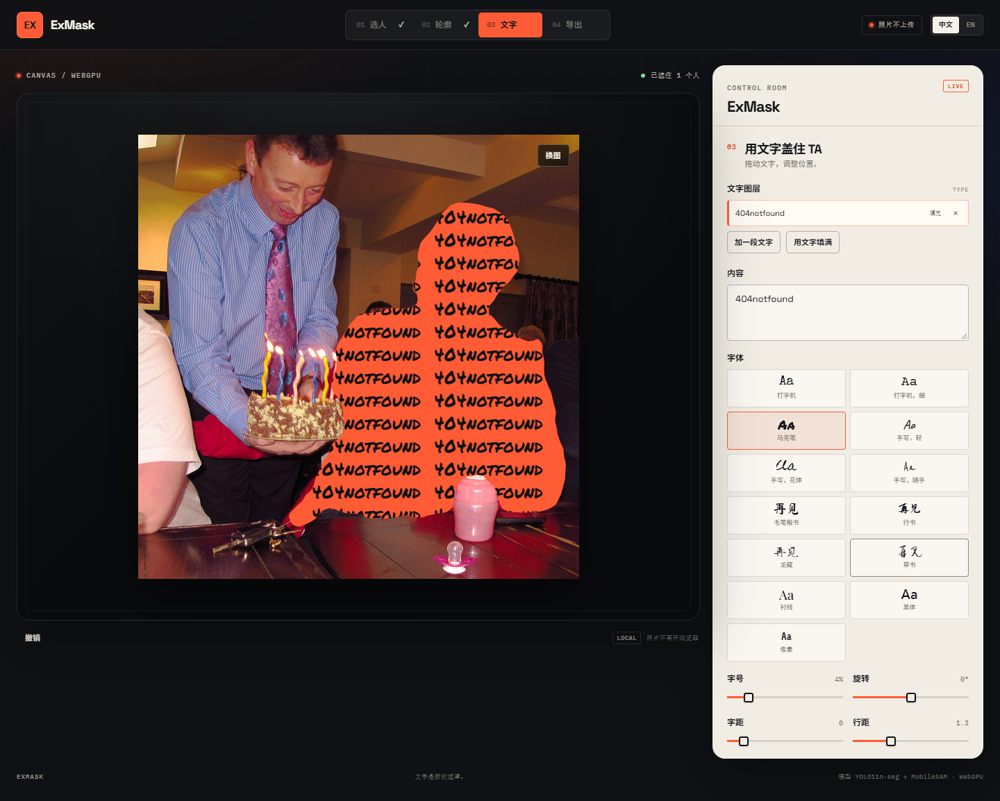

# ExMask · 再见最好的债

**剪影的你轮廓太好看，凝住眼泪才敢细看。**

选中照片里的人物，生成轮廓，再用可编辑的文字把 TA 盖住。检测、分割、排版和导出全部在浏览器本地完成，照片不会上传。

## 效果图

## 流程

1. **选人**：上传照片，点选要遮住的人，也可以用画笔和橡皮精修选区。
2. **轮廓**：调整遮罩颜色、透明度、边缘质感和描边。
3. **文字**：添加文字图层，选择字体、字号、旋转、字距和颜色。
4. **导出**：导出 JPG 或 PNG。

## 技术

- YOLO11n-seg：人物检测
- MobileSAM：点选与框选分割
- ONNX Runtime WebGPU：浏览器端推理
- 纯静态 HTML / CSS / JavaScript，无后端、无上传

## 参考&感谢

 `georgialyu05/ex-eraser`
